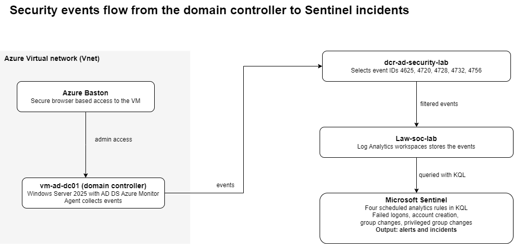
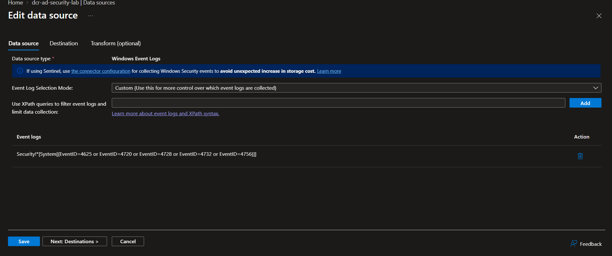
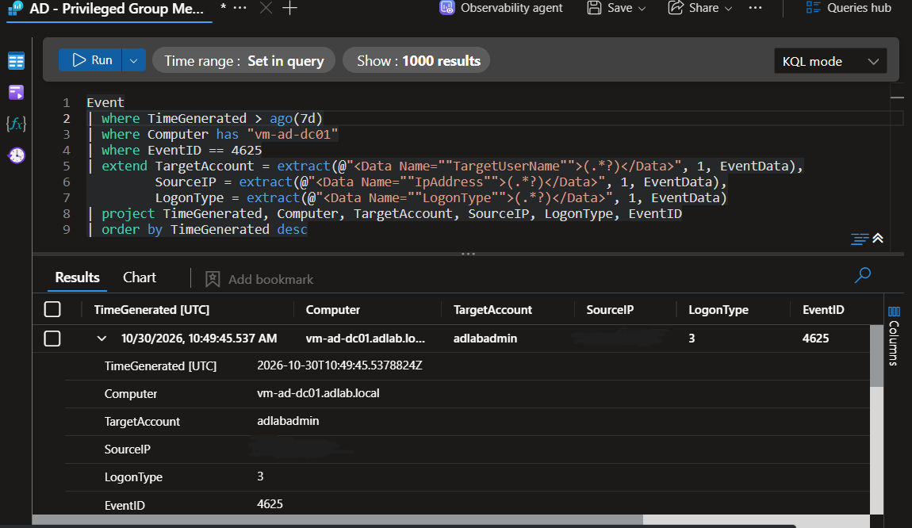
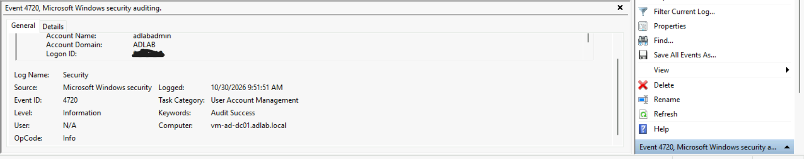
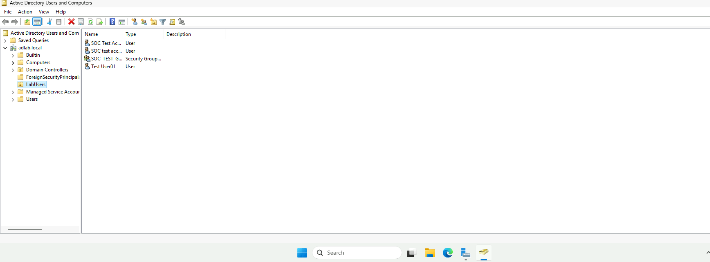
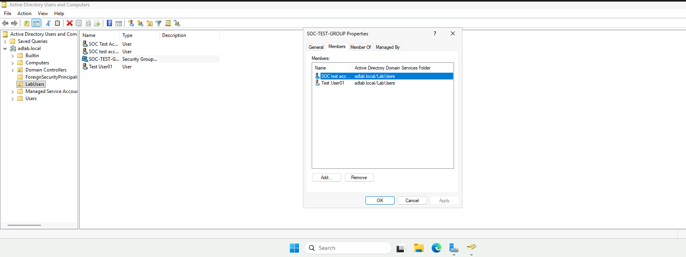
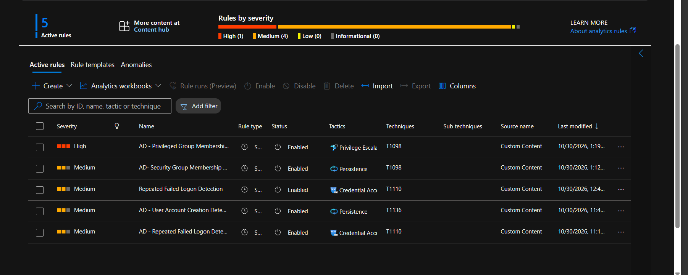
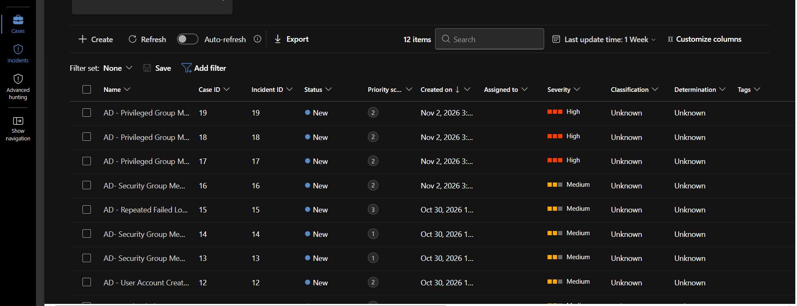

## Active Directory Security Monitoring Lab

### Overview

This project involved building a simulated Active Directory environment in Microsoft Azure and integrating it with Microsoft Sentinel for security monitoring and threat detection.

A Windows Server 2025 virtual machine was configured as a Domain Controller using Active Directory Domain Services (AD DS).

Windows security events were collected using the Azure Monitor Agent (AMA) and a Data Collection Rule (DCR), then sent to a Log Analytics workspace for analysis.

Microsoft Sentinel was used to develop analytics rules to detect suspicious activities, including repeated failed logon attempts, user account creation and security group membership changes.

#### Skills demonstrated
 - SIEM configuration, log collection design, KQL, detection engineering, MITRE ATT&CK mapping, alert testing and incident investigation.

----

### Objectives

- Deploy and configure an Active Directory Domain Controller in Azure.
- Create and manage test users and security groups.
- Configure Windows security event collection using Azure Monitor Agent.
- Integrate security logs with Microsoft Sentinel.
- Develop KQL queries for security event investigation.
- Create analytics rules to detect suspicious Active Directory activity.
- Map relevant detections to the MITRE ATT&CK framework.

---
### Architecture

The lab was deployed in Microsoft Azure using the following components:

| Component | Purpose |
|---|---|
| Azure Virtual Network (VNet) | Provides network connectivity for the lab resources. |
| Windows Server 2025 VM (`vm-ad-dc01`) | Acts as the Active Directory Domain Controller. |
| Active Directory Domain Services (AD DS) | Manages domain users, groups and authentication. |
| Azure Monitor Agent (AMA) | Collects Windows security events. |
| Data Collection Rule (DCR) | Defines which Windows security events are collected. |
| Log Analytics Workspace (`law-soc-lab`) | Stores collected security event data. |
| Microsoft Sentinel | Provides SIEM monitoring, analytics rules and incident investigation. |
| Azure Bastion | Provides secure browser-based access to the virtual machine. |

----

### Data Collection Flow

1. Windows security events are generated on the Domain Controller.
2. Azure Monitor Agent collects the selected events.
3. The Data Collection Rule controls which events are collected.
4. Events are sent to the Log Analytics Workspace.
5. Microsoft Sentinel analyses the data using KQL queries and analytics rules.
6. Matching activity can generate security alerts and incidents.

Events move one way: the agent on the domain controller sends them through the DCR to the workspace, where Sentinel's four rules turn matches into alerts and incidents. Administrators reach the VM through Bastion.

----
### Windows Security Events Monitored

The DCR collects a deliberately small set of Security events rather than everything, to keep ingestion cost and noise down. The events are selected with XPath filters, for example:

 Security!*[System[(EventID=4625)]]

The data connector used was Windows Security Events via AMA with a custom DCR. The relevant audit policy subcategories (Logon, User Account Management, Security Group Management) must be enabled on the DC for these events to be generated.

| Event ID | Description | Security relevance |
|---|---|---|
| 4625 | Failed logon attempt | Identifies repeated authentication failures. |
| 4720 | User account created | Identifies new Active Directory accounts. |
| 4728 | Member added to a global security group | Monitors global group membership changes. |
| 4732 | Member added to a local security group | Monitors local group membership changes. |
| 4756 | Member added to a universal security group | Monitors universal group membership changes. |

----
### Microsoft Sentinel Detection Rules

Four scheduled analytics rules were configured in Microsoft Sentinel to monitor Active Directory security activity.

### 1. Repeated Failed Logon Detection

- **Event ID:** 4625
- **Purpose:** Detects repeated failed logon attempts.
- **Detection logic:** Identifies three or more failed logon attempts within a five-minute period.
- **MITRE ATT&CK:** Credential Access, T1110 (Brute Force)
- **Testing:** Tested by generating multiple incorrect password attempts.
- **Entity mapping:** Account, Host, IP 

- Grouping by target account and source IP separates brute force (many attempts on one account) from password spraying (one source across many accounts, T1110.003). SubStatus distinguishes a wrong password (0xC000006A) from a non-existent user (0xC0000064).

### 2. User Account Creation Detection

- **Event ID:** 4720
- **Purpose:** Detects the creation of new Active Directory user accounts.
- **MITRE ATT&CK:** T1136 – Create Account
- **Testing:** Tested by creating a new test account.
- **Entity mapping:** Account (new account and creator), Host

  

- Capturing who created the account lets an analyst judge whether it was expected. Account creation outside business hours, or by a non-admin, should be treated as higher risk.

### 3. Security Group Membership Change Detection

- **Event IDs:** 4728 and 4732
- **Purpose:** Detects when users are added to global or local security groups.
- **MITRE ATT&CK:** T1098 – Account Manipulation
- **Testing:** Tested by adding test accounts to `SOC-Test-Group`.
- **Severity:** Low to Medium
  

- Privileged groups are excluded here and handled by Rule 4, so one change does not create two incidents.

### 4. Privileged Group Membership Change Detection

- **Event IDs:** 4728, 4732 and 4756
- **Purpose:** Detects additions to sensitive groups such as Domain Admins, Enterprise Admins, Schema Admins and Administrators.
- **MITRE ATT&CK:** T1098 – Account Manipulation
- **Testing:** Detection query and group-name matching logic validated. A real privileged-group membership change has not yet been generated to trigger the rule.

### 5. Microsoft Sentinel Detection

----
### Tools and Technologies

| Tool / Technology | Usage |
|---|---|
| Microsoft Azure | Cloud infrastructure and virtual machine deployment. |
| Windows Server 2025 | Operating system for the Domain Controller. |
| Active Directory Domain Services | Identity and access management. |
| Microsoft Sentinel | Security monitoring and threat detection. |
| Azure Monitor Agent | Windows security event collection. |
| Log Analytics Workspace | Security log storage and analysis. |
| Kusto Query Language (KQL) | Querying and investigating security events. |
| Azure Bastion | Secure remote access to the Domain Controller. |
| MITRE ATT&CK | Mapping detections to recognised attack techniques. |

----

### Testing and Investigation

The lab was tested by generating controlled security events within the Active Directory environment.

The following activities were performed:

- Generated repeated failed logon attempts to test authentication monitoring.
- Created test user accounts to generate Event ID 4720.
- Added test users to `SOC-Test-Group` to generate Event ID 4728.
- Queried Windows security events in Log Analytics using KQL.
- Verified that the corresponding Microsoft Sentinel analytics rules generated alerts and incidents for the tested activities.
- Validated the privileged-group detection query without granting test accounts privileged access.

These tests demonstrated that security events could be collected, queried and used to generate alerts and incidents in Microsoft Sentinel.

----

### What I learned
A detection is only as good as the telemetry behind it and the testing in front of it. Building this lab taught me five things.

• What you collect decides what you can investigate. Filtering the DCR to five event IDs kept the data focused, but without successful logons (4624) I can see failed attempts and cannot tell whether an attacker eventually got in. Collection design is a detection decision, not a setup step.

• Group scope matters. Domain Admins is a global group (4728), Administrators is domain local (4732), and Enterprise and Schema Admins are universal (4756). Detecting "someone joined a privileged group" means covering all three event IDs and matching on group names.

• A rule that fires is not yet a good rule. Rules 2 to 4 alert on every matching event, so legitimate administration would trigger them. Who made the change, when, and to which group is what separates a real alert from noise. Rules 3 and 4 also overlap, so one privileged change can raise two incidents.

• An untested detection is a hypothesis. Rules 1 to 3 were proven by generating the activity and seeing the incident. Rule 4 was only validated by its query logic, and I treat it as unproven until a real privileged-group change triggers it.

• Self-generated telemetry is clean telemetry. I created every event from inside the lab, so the results show the pipeline works, not how the rules behave against real attacker noise.

